# Detección de objetos con Faster R-CNN y YOLO en imágenes y video

**Informe-resumen del trabajo**

**Universidad Nacional del Altiplano – Escuela Profesional de Ingeniería de Sistemas**
**Curso:** Visión Artificial · **Docente:** Ing. Fernández Chambi Mayenka · **Semestre:** X · **Grupo:** B

### Integrantes

* Ancco García José Manuel
* Mestas Calsín Alex Cristian
* Messco Condori Benigno Saúl
* Quispe Soncco Willebeldo Fermín
* Ticona Erquinigo Jhoel Jovani

Este repositorio compara dos familias de detectores de objetos en dos escenarios:

* **Faster R-CNN**, un detector de dos etapas.
* **YOLO**, un detector de una etapa.
* Los escenarios son **imágenes fijas** y **video en tiempo real**.

Todo se ejecutó en la misma computadora, una CPU AMD con Windows y sin GPU. La comparación se basa en métricas calculadas por los propios scripts.

| Parte | Qué se hizo | Dónde está |
|---|---|---|
| a | Faster R-CNN en imágenes | `metrica_imagenes/a_faster_rcnn_imagenes.py` |
| b | YOLO en imágenes | `metrica_imagenes/b_yolo_imagenes.py` |
| c | Faster R-CNN en video / tiempo real | `metrica_videos/detector_faster_rcnn.py` |
| d | YOLO en video / tiempo real | `metrica_videos/d_deteccion_de_objetos_yolo.py` |
| e | Comportamiento en imagen vs. video según métricas | `e_comparar_imagenes.py`, `e_comparar_video.py` y la [sección 6](#6-parte-e-imagen-vs-video-qué-dicen-las-métricas) |
| f | Informe-resumen | este README |
---

## Resultados principales

* **Precisión en imágenes: prácticamente empatan.**
  * El mAP@[.5:.95] es de **0,431** para Faster R-CNN y de **0,427** para YOLOv8n.
  * Faster R-CNN encuentra más objetos: tiene mayor recall, mayor mAP@.5 y un AP en objetos pequeños un 30 % más alto.
  * YOLO ubica las cajas un poco más ajustadas, con un mAP@.75 ligeramente mayor.
* **Velocidad en imágenes: YOLO es unas 31 veces más rápido.** Tarda 69 ms por imagen, frente a 2173 ms de Faster R-CNN.
* **Video: ninguno llega a tiempo real (30 FPS) en CPU.**
  * YOLO procesa **18,8 FPS**, con un factor de tiempo real de 0,63.
  * Faster R-CNN, ya con un modelo ligero, procesa **8,3 FPS**, con un factor de 0,28.
* **YOLO es un poco más estable en video.** Su estabilidad temporal es de 0,854 frente a 0,831, y su conteo de objetos varía menos entre fotogramas.
* **La diferencia de arquitectura se nota en el tiempo.**
  * El costo de Faster R-CNN depende del contenido: 72 ms en fotogramas vacíos y 124 ms con objetos.
  * El de YOLO es casi constante: 53 ms en ambos casos.

---

## 1. Metodología

### Modelos

| | Faster R-CNN | YOLO |
|---|---|---|
| Tipo | Dos etapas: primero propone regiones (RPN) y luego las clasifica y ajusta | Una etapa: predice cajas y clases en una sola pasada sobre una rejilla |
| Imágenes (a, b) | Faster R-CNN **ResNet-50 + FPN** (ONNX), 80 clases COCO | **YOLOv8n** (nano, 3,2 M de parámetros), 80 clases COCO, entrada de 640 px |
| Video (c, d) | Faster R-CNN **MobileNetV3-Large-320 + FPN** (torchvision), ancho de 640 px | **YOLOv8n**, restringido a 10 clases (personas, vehículos y animales) |
| Umbral de confianza | 0,5 en imágenes; 0,6 en video | 0,5 en imágenes; 0,45 en video |

### Datos

* **Imágenes:** *coco128*, que tiene 128 imágenes de COCO con **929 objetos etiquetados** de 71 clases. Ambos modelos se evaluaron con las mismas imágenes y el mismo protocolo (`pycocotools`).
* **Video:** el mismo archivo `11.mp4` para ambos modelos, una escena urbana de 1304 fotogramas a 29,97 FPS.

### Métricas

| Escenario | Métrica | Qué indica |
|---|---|---|
| Imagen | **mAP@[.5:.95]** | Precisión media promediada en IoU de 0,50 a 0,95. Es la métrica principal de COCO y no depende del umbral de confianza |
| Imagen | mAP@.5 / mAP@.75 | Lo mismo, pero con una exigencia de solape baja (0,5) o alta (0,75) |
| Imagen | AP pequeños / medianos / grandes | AP según el tamaño del objeto (pequeño < 32² px; grande > 96² px) |
| Imagen | Precisión, recall y F1 | Con conf ≥ 0,5 e IoU ≥ 0,5; además, un barrido de umbrales de 0,1 a 0,9 |
| Imagen | Latencia y FPS | Tiempo por imagen |
| Video | Latencia y FPS del modelo | Tiempo por fotograma. Para 30 FPS hacen falta **≤ 33 ms** |
| Video | Factor de tiempo real | FPS del modelo ÷ FPS del video. Con un valor ≥ 1, el modelo alcanza a la cámara |
| Video | Estabilidad temporal | Fracción de detecciones que siguen en el fotograma siguiente (misma clase, IoU ≥ 0,5) |
| Video | Variación del conteo | Cambio medio en el número de objetos de un fotograma al siguiente |

En video no hay etiquetas reales, por eso **no se calcula mAP**. El video se evalúa por velocidad y consistencia. Los 5 primeros fotogramas no cuentan en los tiempos porque incluyen la carga del modelo.

---

## 2. Parte a: Faster R-CNN en imágenes

| mAP@[.5:.95] | mAP@.5 | mAP@.75 | AR@100 | P / R / F1 (conf 0,5) | Latencia media | FPS |
|---|---|---|---|---|---|---|
| **0,431** | 0,666 | 0,445 | 0,529 | 0,670 / 0,643 / 0,656 | 2173 ms (p95: 2609 ms) | 0,46 |

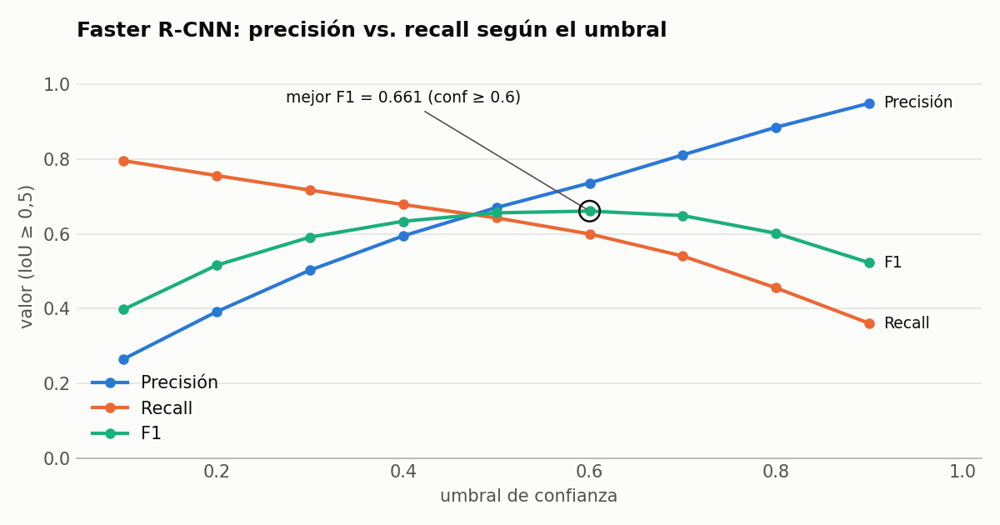

**Interpretación**

* Al subir el umbral de confianza, la precisión crece y el recall cae.
* El mejor equilibrio (**F1 = 0,661**) está en **conf = 0,6**, muy cerca del 0,5 usado.
* Las puntuaciones de Faster R-CNN están bien calibradas: una detección con 0,6 o más suele ser correcta.
* Con conf ≥ 0,5 hace **891 detecciones** y acierta **597** de los 929 objetos.
* El costo es la velocidad: más de 2 segundos por imagen en CPU.

## 3. Parte b: YOLO en imágenes

| mAP@[.5:.95] | mAP@.5 | mAP@.75 | AR@100 | P / R / F1 (conf 0,5) | Latencia media | FPS |
|---|---|---|---|---|---|---|
| **0,427** | 0,580 | 0,454 | 0,494 | 0,892 / 0,357 / 0,510 | 69 ms (p95: 112 ms)¹ | 14,5 |

¹ Este es el valor de la tabla comparativa. El `metricas.json` de la parte b, de otra ejecución, registra 67 ms (14,9 FPS). Es la variación normal entre corridas.

**Interpretación**

* Con conf ≥ 0,5, YOLO hace solo **372 detecciones** y acierta 332. Es muy preciso (0,892), pero deja sin detectar casi dos tercios de los objetos (recall 0,357).
* No significa que "vea menos". Sus puntuaciones son más bajas que las de Faster R-CNN, y su mejor F1 (**0,609**) aparece en **conf = 0,2**.
* Un mismo umbral de 0,5 no significa lo mismo en los dos modelos. Por eso la comparación justa se hace con el mAP, que no depende del umbral.

---

## 4. Comparación en imágenes (a vs. b)

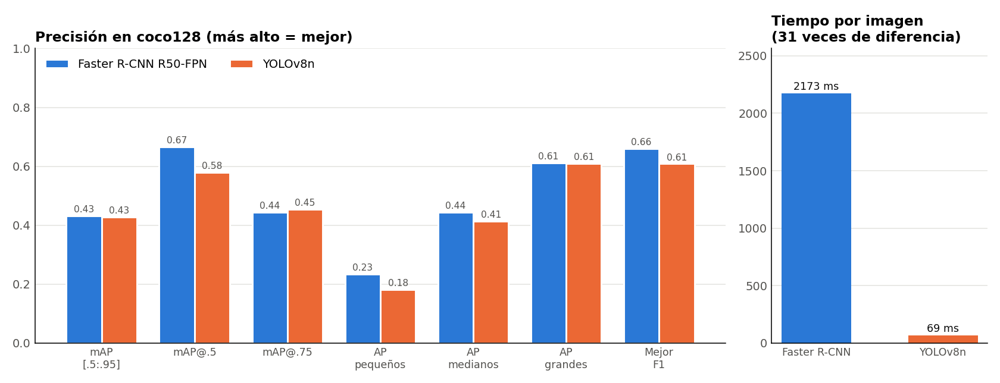

| Métrica | Faster R-CNN R50-FPN | YOLOv8n | Mejor |
|---|---|---|---|
| **mAP@[.5:.95]** | 0,431 | 0,427 | ≈ empate |
| mAP@.5 | **0,666** | 0,580 | Faster R-CNN |
| mAP@.75 | 0,445 | **0,454** | YOLO |
| AP en objetos pequeños | **0,235** | 0,181 | Faster R-CNN (+30 %) |
| AP en objetos medianos | **0,443** | 0,414 | Faster R-CNN |
| AP en objetos grandes | 0,612 | 0,610 | ≈ empate |
| AR@100 (recall máximo) | **0,529** | 0,494 | Faster R-CNN |
| Mejor F1 (umbral) | **0,661** (0,6) | 0,609 (0,2) | Faster R-CNN |
| Latencia media | 2173 ms | **69 ms** | YOLO (31×) |

<p align="center">
  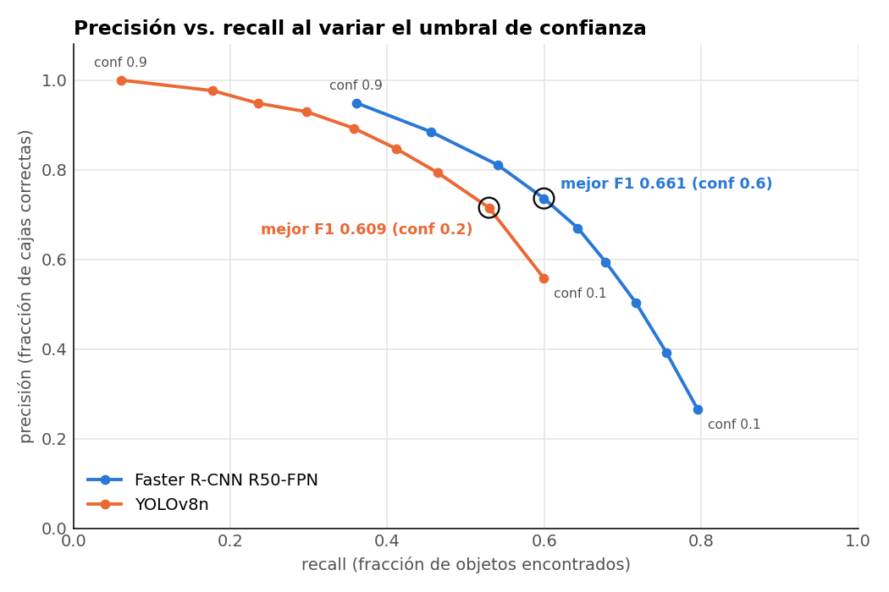
  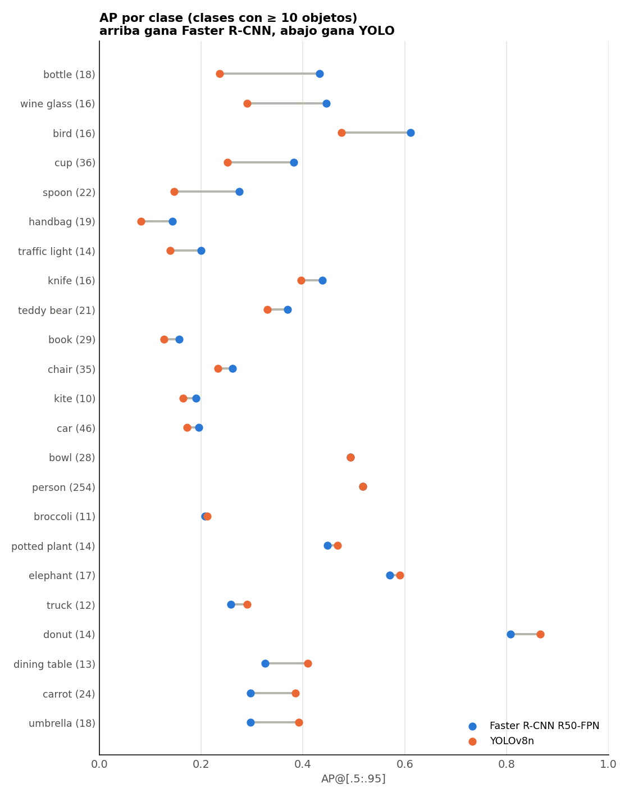
</p>

**Interpretación**

1. **El empate en mAP oculta dos estilos distintos.**
   * Faster R-CNN gana con claridad en mAP@.5: **detecta más objetos**.
   * YOLO gana por poco en mAP@.75: **sus cajas son algo más ajustadas** cuando acierta.
   * Al promediar todos los IoU, las dos ventajas se compensan.
2. **Faster R-CNN es mejor con objetos pequeños.** Su AP en objetos pequeños es de 0,235 frente a 0,181, y su AR en objetos pequeños, de 0,319 frente a 0,215. Hay tres razones:
   * La FPN combina varias escalas.
   * Trabaja con imágenes a mayor resolución.
   * La segunda etapa revisa cada región propuesta en detalle.
   * Por eso gana en clases pequeñas o delgadas: botellas (+0,20), copas (+0,16), aves (+0,14), tazas (+0,13) y cucharas (+0,13).
3. **YOLO gana en algunas clases.** Por ejemplo, paraguas, zanahorias, mesas y donas. En personas y bowls empatan.
4. **La curva precisión-recall de Faster R-CNN está por encima en casi todo el recorrido.**
   * Con el umbral adecuado, consigue más precisión para el mismo recall.
   * YOLO no pasa de un recall de 0,60 ni con conf 0,1.
5. **Velocidad:** con una diferencia de 31×, YOLO es la única opción práctica en CPU si importa el tiempo de respuesta.

### Ejemplos (mismas imágenes; izquierda: Faster R-CNN, derecha: YOLOv8n)

| Faster R-CNN | YOLOv8n |
|---|---|
| 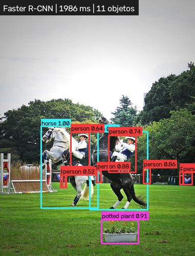 | 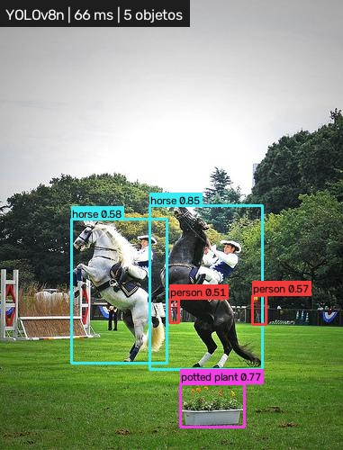 |
| 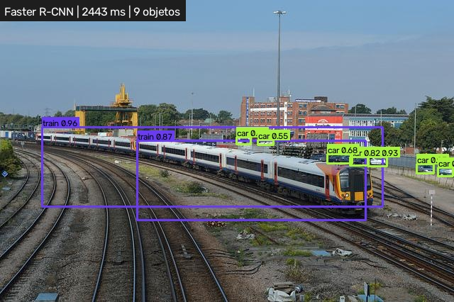 | 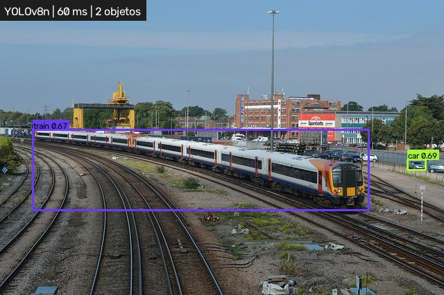 |
| 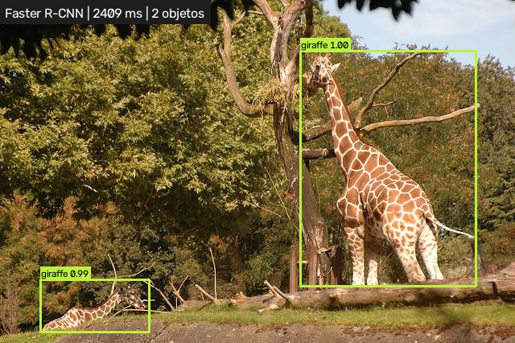 | 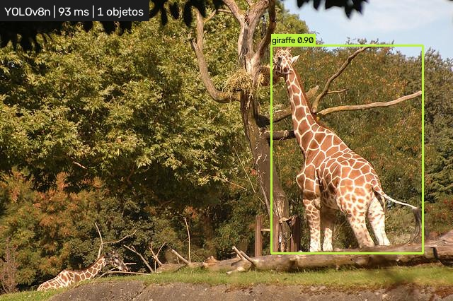 |
| 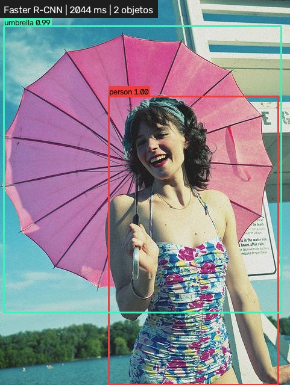 | 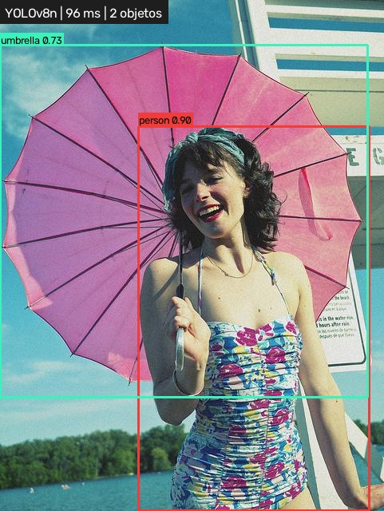 |

**Interpretación de los ejemplos**

* **Caballos y jinetes:** Faster R-CNN detecta **11 objetos** y YOLO, **5**. Faster R-CNN encuentra a los jinetes y a las personas del fondo.
* **Estación de tren:** Faster R-CNN encuentra **9 objetos**, entre ellos vehículos pequeños y lejanos. YOLO encuentra **2**. Es el efecto del AP en objetos pequeños.
* **Jirafas:** solo Faster R-CNN detecta la jirafa pequeña echada en el fondo.
* **Paraguas:** en una escena simple, ambos aciertan las mismas 2 cajas. Faster R-CNN lo hace con más confianza (0,99 y 1,00 frente a 0,73 y 0,90), pero YOLO tarda **96 ms** frente a **2044 ms**.

---

## 5. Partes c y d: detección en video

<p align="center">
  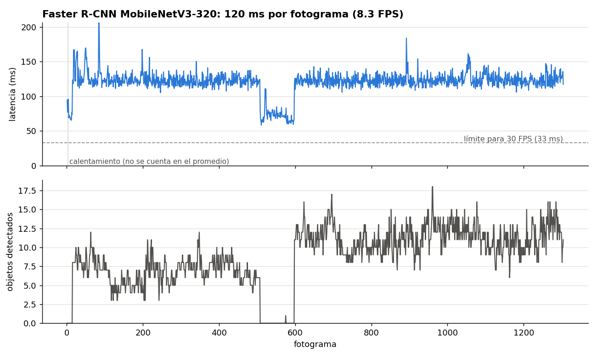
  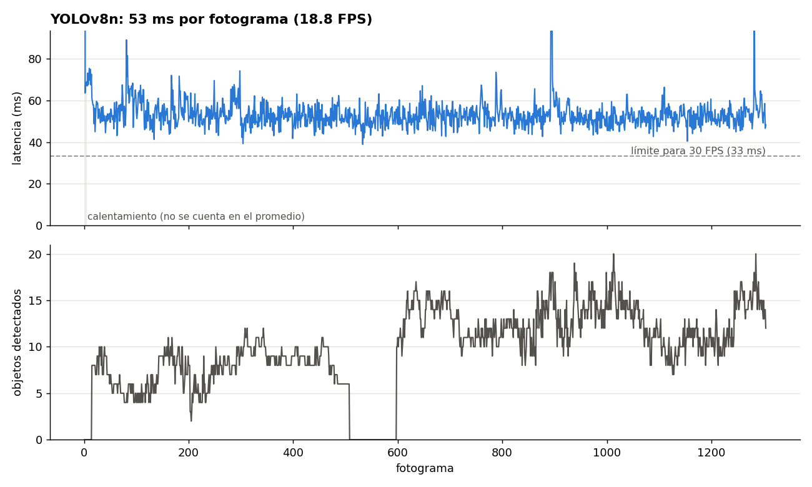
</p>

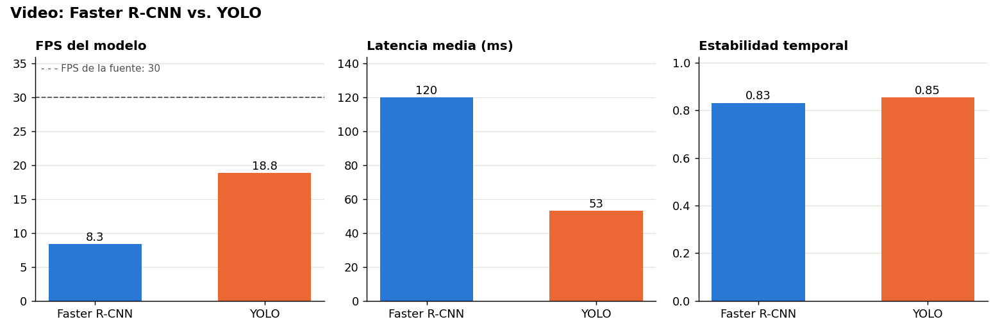

| Métrica | Faster R-CNN MobileNetV3-320 (c) | YOLOv8n (d) |
|---|---|---|
| Umbral de confianza | 0,60 | 0,45 |
| Latencia media / mediana / p95 | 120,0 / 121,7 / 137,7 ms | **53,2 / 52,5 / 63,2 ms** |
| FPS del modelo / bucle completo | 8,33 / 7,59 | **18,81 / 15,51** |
| Factor de tiempo real | 0,28 | **0,63** |
| Fotogramas perdidos en vivo (estimado) | 72,2 % | **37,3 %** |
| Objetos por fotograma (máximo) | 8,71 (18) | 9,73 (20) |
| Confianza media | **0,856** | 0,692 |
| Estabilidad temporal | 0,831 | **0,854** |
| Variación del conteo | 0,94 | **0,81** |
| Tiempo total para 1304 fotogramas | 171,6 s | **84,2 s** |
| Clases más detectadas | personas 9936, motos 642, autos 427, buses 123 | personas 11 792, autos 426, motos 404, camiones 68 |

**Interpretación**

* **Ninguno llega a tiempo real en CPU.** Para 30 FPS el presupuesto es de 33 ms por fotograma.
  * YOLO tarda 53 ms y procesa unos 2 de cada 3 fotogramas.
  * Faster R-CNN tarda 120 ms y procesa poco más de 1 de cada 4.
  * Con una cámara en vivo, el video de Faster R-CNN se vería "a saltos".
* **YOLO es 2,3 veces más rápido y más regular.** Su p95 (63 ms) está muy cerca de su media.
* **El conteo de objetos sigue la escena en ambos modelos.**
  * Hay un tramo sin objetos (fotogramas ~505–600) y luego una escena más concurrida.
  * Los dos modelos registran esos mismos cambios, lo que indica que miden lo mismo.
  * Ambos detectan casi la misma cantidad de autos (427 y 426).
* **Estabilidad:** en ambos, alrededor del 15 % de las detecciones "parpadea" entre fotogramas. YOLO es algo más estable a pesar de usar un umbral más bajo.

---

## 6. Parte e: imagen vs. video, qué dicen las métricas

| Aspecto | Imágenes | Video |
|---|---|---|
| Qué se mide | Precisión (mAP, P, R) contra etiquetas reales | Velocidad y consistencia (no hay etiquetas) |
| Faster R-CNN | R50-FPN: 2173 ms y mAP 0,431 | MobileNetV3-320: 120 ms, **18 veces más rápido**, pero con un modelo menos preciso |
| YOLOv8n | 69 ms | 53 ms (mismo orden) |
| Quién detecta más | Faster R-CNN (891 frente a 372 detecciones con conf 0,5) | YOLO (9,7 frente a 8,7 objetos por fotograma) |
| Confianza media | Faster R-CNN 0,806; YOLO 0,751 | Faster R-CNN 0,856; YOLO 0,692 |

1. **En imagen importa acertar; en video importa llegar a tiempo.**
   * En una foto da igual que el modelo tarde 2 s.
   * En video, con 2173 ms por fotograma, Faster R-CNN R50-FPN procesaría **menos del 2 %** de los fotogramas (0,46 de 30 FPS).
   * Por eso la parte c tuvo que usar una versión ligera (MobileNetV3 a 320 px).
   * Esa versión gana 18 veces en velocidad, pero en COCO val tiene un mAP oficial de 22,8 frente a 37,0 del R50-FPN de torchvision.
   * YOLOv8n, en cambio, sirve igual para ambos escenarios sin cambiar el modelo.
2. **La ventaja de Faster R-CNN en imágenes no se traslada al video.**
   * En imágenes detecta 2,4 veces más objetos que YOLO. En video, YOLO detecta más.
   * El modelo de video es otro, más débil con objetos pequeños por trabajar a 320 px.
   * Además, su umbral es más alto (0,6 frente a 0,45).
   * Conclusión: **la precisión medida en imágenes vale para ese modelo exacto, no para su familia.**
3. **La arquitectura se ve en la latencia.**
   * En Faster R-CNN, la segunda etapa trabaja sobre las regiones que propone la RPN. Con menos regiones relevantes hay menos trabajo: **72 ms en fotogramas vacíos frente a 124 ms con objetos**.
   * YOLO hace una sola pasada fija sobre toda la imagen: **53 ms en ambos casos**.
   * Un detector de una etapa tiene un tiempo **predecible**, algo clave en tiempo real.
4. **La confianza cambia según el umbral y el tipo de entrada.**
   * La de Faster R-CNN sube en video (0,806 a 0,856) porque su umbral subió a 0,6 y descarta las detecciones dudosas.
   * La de YOLO baja (0,751 a 0,692): su umbral bajó a 0,45, y los fotogramas de video tienen desenfoque por movimiento y compresión.
5. **El video añade una dimensión que la imagen no tiene: la estabilidad en el tiempo.**
   * Un modelo con buen mAP puede parpadear entre fotogramas.
   * Aquí ambos son similares, con una ligera ventaja de YOLO.

---

## 7. Conclusiones

* **En imágenes, ambos modelos tienen la misma precisión global (mAP ≈ 0,43), con perfiles distintos.**
  * Faster R-CNN encuentra más objetos, sobre todo pequeños.
  * YOLO es más conservador y ajusta un poco mejor las cajas.
* **Cuando importa no perder objetos** (análisis offline, objetos pequeños, revisión de fotos), conviene Faster R-CNN con umbral ≈ 0,6.
* **Cuando importa el tiempo** (video, cámara, hardware sin GPU), conviene YOLO.
  * Es 31 veces más rápido en imágenes y 2,3 veces más rápido en video.
  * Su latencia es estable y sus detecciones parpadean un poco menos.
* **El umbral de confianza se debe ajustar a cada modelo:** el mejor F1 está en 0,6 para Faster R-CNN y en 0,2 para YOLO. Comparar ambos con el mismo umbral fijo es injusto. El mAP es la métrica neutral.
* **En CPU ninguno alcanza 30 FPS.** Para tiempo real habría que usar GPU, bajar la resolución, procesar uno de cada N fotogramas o exportar el modelo a ONNX u OpenVINO.

## 8. Limitaciones

* **coco128 son imágenes del conjunto de entrenamiento de COCO**, así que el mAP absoluto es optimista. Los valores de referencia en COCO val son ≈ 35–37 para Faster R-CNN R50-FPN (según la implementación) y 37,3 para YOLOv8n. La comparación **entre** modelos sigue siendo válida porque ambos se entrenaron con los mismos datos.
* **En video los modelos no son exactamente equivalentes:**
  * Los umbrales son distintos (0,6 y 0,45).
  * YOLO está restringido a 10 clases; por ejemplo, no tiene la clase "bus".
  * El Faster R-CNN de video no es el mismo que el de imágenes.
* Sin etiquetas en el video no hay mAP: la calidad en video se infiere de la estabilidad, la confianza y los conteos.
* Son tiempos de una sola CPU y pueden variar entre ejecuciones (±3 %).

---

## 9. Estructura del repositorio y cómo reproducir

```
metrica_imagenes/
├── a_faster_rcnn_imagenes.py      # parte a
├── b_yolo_imagenes.py             # parte b
├── e_comparar_imagenes.py         # parte e (imágenes)
└── resultados/
    ├── a_faster_rcnn_imagenes/    # metricas.json, gráficos, ejemplos/
    ├── b_yolo_imagenes/           # metricas.json, ejemplos/
    └── e_comparacion/             # tabla .md y gráficos comparativos
metrica_videos/
├── detector_faster_rcnn.py        # parte c
├── d_deteccion_de_objetos_yolo.py # parte d
├── e_comparar_video.py            # parte e (video)
└── resultados/
    ├── c_faster_rcnn_video/       # resumen_metricas.json, CSV por fotograma, gráfico
    ├── d_yolo_video/
    └── e_comparacion/
```

```bash
pip install ultralytics torch torchvision onnxruntime opencv-python pycocotools matplotlib

# Imágenes (coco128 y los pesos se descargan solos)
cd metrica_imagenes
python a_faster_rcnn_imagenes.py
python b_yolo_imagenes.py --modelo yolov8n.pt --metricas
python e_comparar_imagenes.py

# Video (usar el mismo archivo en c y d)
cd ../metrica_videos
python detector_faster_rcnn.py --video ruta/al/video.mp4 --conf 0.6
python d_deteccion_de_objetos_yolo.py      # opción 2 y la ruta del video
python e_comparar_video.py
```

## 10. Referencias

* Ren, S., He, K., Girshick, R. y Sun, J. (2015). *Faster R-CNN: Towards Real-Time Object Detection with Region Proposal Networks*. NeurIPS. https://arxiv.org/abs/1506.01497
* Redmon, J., Divvala, S., Girshick, R. y Farhadi, A. (2016). *You Only Look Once: Unified, Real-Time Object Detection*. CVPR. https://arxiv.org/abs/1506.02640
* Jocher, G. et al. (2023). *Ultralytics YOLOv8*. https://docs.ultralytics.com/models/yolov8/
* Lin, T.-Y. et al. (2014). *Microsoft COCO: Common Objects in Context*. ECCV. https://cocodataset.org
* TorchVision, modelos de detección y sus métricas en COCO. https://pytorch.org/vision/stable/models.html
